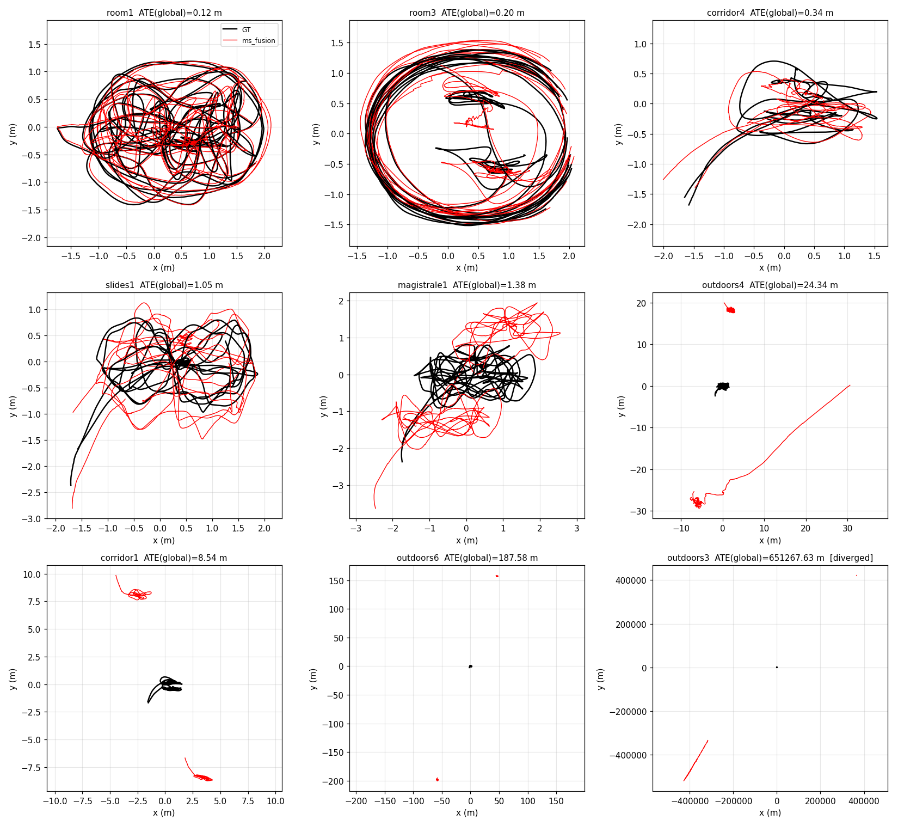
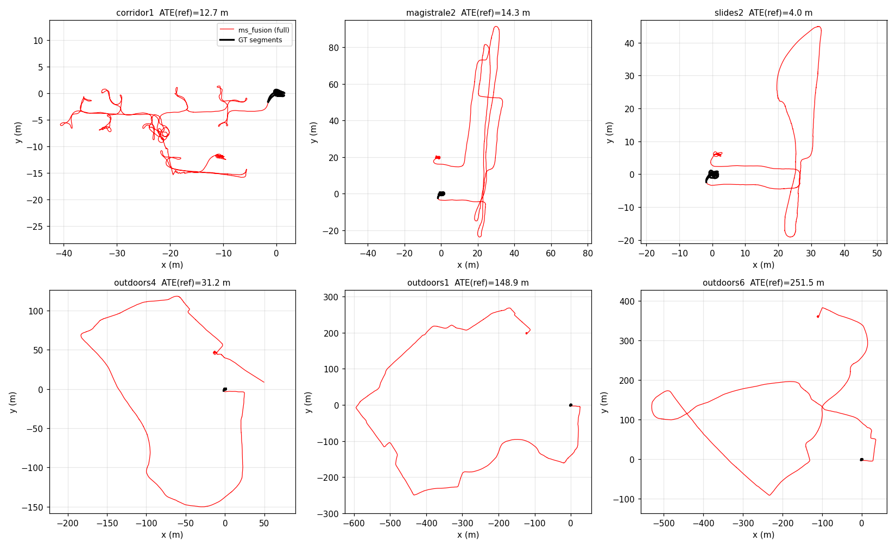

# TUM VI 全序列评测结果

在 AX650N 板端（离线回放，**1.0× 原始时基**）对 TUM VI 官方 512_16 导出的 **28 条序列 × 3 次**运行（共 84 次）的结果。
所有序列使用**同一份配置**（`calib_files/tumvi_room1/msf_robot.yaml` + 官方标定，仅 IMU 噪声按标定换算），
**没有逐序列调参，回环关闭（纯 VIO）**。

- 前端：XFeat 每帧 256 个特征点 + LightGlue 匹配（NPU），滑窗 `optimizer.window_size=8`，后端 Ceres。
- 板端以 `enable_timing_stats` 运行，耗时统计本身有少量开销。
- 逐次明细：[`runs.csv`](runs.csv)；表格生成与轨迹绘图脚本：`scripts/tumvi_report.py`、`scripts/tumvi_plot.py`。

## 指标说明

| 列 | 含义 |
|---|---|
| ATE Global-SE3 | **一次** SE(3)（无尺度）对齐，用该序列**全部有效 GT 位姿**拟合，再算全部点的 RMSE。对应 ORB-SLAM3 公开评估流程（单次整体对齐）的候选对比口径；对齐会吸收一部分累计误差。注：对应的是公开调用流程，未逐行核对其脚本实现 |
| ATE Reference-SE3（First-segment-aligned） | 只用**第一段有效 GT** 拟合 SE(3)，其余片段用同一变换，完整保留跨片段累计漂移。它通常比 Global-SE3 更能暴露累计漂移，但数学上不必然更大，也不是公开 Benchmark 的通用标准 |
| ATE Own-SE3 | **每个 GT 片段各自对齐**。只反映片段内部形状，会把片段间漂移拟合掉，**不能代表长期漂移**，仅用于局部诊断 |
| RPE 1s | 1 秒位移的平移误差 RMSE（用整体对齐的旋转把估计位移转到 GT 系，仅平移，不含旋转 RPE；只在同一无间断 GT 片段内配对） |
| 初始化失败 | 该序列 3 次运行中未完成初始化的次数 |
| 回环 | 本评测回环关闭，因此无回环数据 |
| 前端 Hz | 前端处理帧率（1 秒窗口的中位数，相机 20 Hz） |
| 前端 e2e / 后端 / 后端优化 P95 | **每个 1 秒统计窗口的均值所构成分布的 P95**（单位 ms），不是所有单次后端优化耗时的 P95 |
| 后端丢帧 | 关键帧在后端队列中被丢弃的次数 / 分钟 |
| GT 覆盖 | TUM VI 的动捕真值只在序列首尾（房间内）；**ATE 只在有 GT 的这些片段内计算**，不是整条轨迹。例如 corridor1 全程 299 s，GT 只有 2 段共 52 s |

除"完成/发散"列外，数值均为 3 次运行的**中位数**；仅统计状态为 `evaluated` 的运行。
"完成/发散"只表示**是否通过预设的发散筛查**（见下），不等于跟踪成功率；筛查只抓明显失效，抓不到中等漂移，精度请看 ATE。
发散判定（任一成立）：0.5 s 窗口内速度 > 20 m/s，或某 GT 片段内估计路程 / GT 路程不在 [1/2, 2]。
发散的序列 ATE 记为 N/A（数值无意义）。

## 全量结果（基线配置）

| 序列 | 完成/发散 | ATE Global-SE3 (m) | ATE Reference-SE3 (m) | ATE Own-SE3 (m) | RPE 1s (m) | 初始化失败 | 回环 | 前端 Hz | 前端 e2e P95 (ms) | 后端 P95 (ms) | 后端优化 P95 (ms) | 后端丢帧 (次/分) | GT 覆盖 |
|---|---:|---:|---:|---:|---:|---:|---:|---:|---:|---:|---:|---:|---|
| room1 | 3/3, 发散 0 | 0.12 | 0.14 | 0.07 | 0.036 | 0 | 关闭 | 19.3 | 92 | 80 | 70 | 12.8 | 3 段 / 139 s（序列 GT 跨度 141 s） |
| room2 | 3/3, 发散 0 | 0.16 | 0.25 | 0.05 | 0.049 | 0 | 关闭 | 19.2 | 91 | 89 | 79 | 18.6 | 10 段 / 131 s（序列 GT 跨度 144 s） |
| room3 | 3/3, 发散 0 | 0.20 | 0.23 | 0.15 | 0.047 | 0 | 关闭 | 19.1 | 91 | 98 | 89 | 34.9 | 10 段 / 130 s（序列 GT 跨度 141 s） |
| room4 | 3/3, 发散 0 | 0.10 | 0.10 | 0.10 | 0.029 | 0 | 关闭 | 19.6 | 90 | 79 | 69 | 10.7 | 1 段 / 111 s（序列 GT 跨度 111 s） |
| room5 | 3/3, 发散 0 | 0.17 | 0.17 | 0.17 | 0.052 | 0 | 关闭 | 19.2 | 91 | 76 | 67 | 10.4 | 1 段 / 142 s（序列 GT 跨度 142 s） |
| room6 | 3/3, 发散 0 | 0.05 | 0.06 | 0.04 | 0.017 | 0 | 关闭 | 19.9 | 87 | 90 | 78 | 19.4 | 2 段 / 128 s（序列 GT 跨度 131 s） |
| corridor1 | 3/3, 发散 0 | 8.54 | 12.67 | 0.10 | 0.648 | 0 | 关闭 | 19.5 | 90 | 97 | 87 | 23.7 | 2 段 / 52 s（序列 GT 跨度 299 s） |
| corridor2 | 3/3, 发散 0 | 2.02 | 3.00 | 0.17 | 0.158 | 0 | 关闭 | 19.8 | 91 | 93 | 83 | 25.5 | 2 段 / 71 s（序列 GT 跨度 339 s） |
| corridor3 | 3/3, 发散 0 | 2.29 | 3.63 | 0.10 | 0.189 | 0 | 关闭 | 19.6 | 90 | 87 | 78 | 15.1 | 2 段 / 60 s（序列 GT 跨度 290 s） |
| corridor4 | 3/3, 发散 0 | 0.34 | 0.55 | 0.10 | 0.164 | 0 | 关闭 | 19.7 | 91 | 91 | 82 | 20.0 | 2 段 / 53 s（序列 GT 跨度 94 s） |
| corridor5 | 3/3, 发散 0 | 0.88 | 0.89 | 0.03 | 0.092 | 0 | 关闭 | 19.7 | 91 | 95 | 85 | 25.6 | 3 段 / 40 s（序列 GT 跨度 285 s） |
| magistrale1 | 3/3, 发散 0 | 1.38 | 1.95 | 0.08 | 0.103 | 0 | 关闭 | 19.4 | 92 | 94 | 84 | 23.0 | 2 段 / 119 s（序列 GT 跨度 770 s） |
| magistrale2 | 3/3, 发散 0 | 9.95 | 14.29 | 0.06 | 0.434 | 0 | 关闭 | 19.4 | 93 | 100 | 90 | 28.7 | 2 段 / 98 s（序列 GT 跨度 538 s） |
| magistrale3 | 3/3, 发散 0 | 4.01 | 6.09 | 0.08 | 0.722 | 0 | 关闭 | 19.5 | 92 | 99 | 90 | 28.4 | 2 段 / 105 s（序列 GT 跨度 483 s） |
| magistrale4 | 3/3, 发散 0 | 9.87 | 14.47 | 0.39 | 1.113 | 0 | 关闭 | 19.7 | 92 | 95 | 85 | 24.1 | 2 段 / 148 s（序列 GT 跨度 623 s） |
| magistrale5 | 3/3, 发散 0 | 2.68 | 3.80 | 0.06 | 0.110 | 0 | 关闭 | 19.6 | 92 | 95 | 85 | 25.2 | 2 段 / 101 s（序列 GT 跨度 446 s） |
| magistrale6 | 3/3, 发散 0 | 5.75 | 8.62 | 0.10 | 0.553 | 0 | 关闭 | 19.8 | 91 | 102 | 92 | 48.3 | 2 段 / 79 s（序列 GT 跨度 575 s） |
| outdoors1 | 3/3, 发散 0 | 114.96 | 148.85 | 0.18 | 0.871 | 0 | 关闭 | 19.0 | 92 | 91 | 81 | 10.3 | 2 段 / 119 s（序列 GT 跨度 1282 s） |
| outdoors2 | 3/3, 发散 0 | 81.38 | 109.50 | 10.52 | 2.343 | 0 | 关闭 | 19.7 | 92 | 113 | 102 | 37.6 | 2 段 / 107 s（序列 GT 跨度 922 s） |
| outdoors3 | 0/3, 发散 3 | N/A | N/A | N/A | N/A | 0 | 关闭 | 19.9 | 89 | 68 | 58 | 2.7 | 3 段 / 120 s（序列 GT 跨度 844 s） |
| outdoors4 | 3/3, 发散 0 | 24.34 | 31.22 | 9.94 | 2.157 | 0 | 关闭 | 19.8 | 92 | 90 | 81 | 14.3 | 2 段 / 128 s（序列 GT 跨度 700 s） |
| outdoors5 | 0/3, 发散 3 | N/A | N/A | N/A | N/A | 0 | 关闭 | 19.9 | 90 | 107 | 97 | 44.7 | 2 段 / 138 s（序列 GT 跨度 887 s） |
| outdoors6 | 3/3, 发散 0 | 187.58 | 251.51 | 0.48 | 0.981 | 0 | 关闭 | 18.9 | 92 | 93 | 84 | 11.9 | 4 段 / 113 s（序列 GT 跨度 1470 s） |
| outdoors7 | 3/3, 发散 0 | 20.45 | 29.89 | 0.21 | 0.436 | 0 | 关闭 | 19.4 | 92 | 105 | 96 | 32.5 | 2 段 / 81 s（序列 GT 跨度 1120 s） |
| outdoors8 | 3/3, 发散 0 | 20.11 | 30.66 | 0.75 | 0.605 | 0 | 关闭 | 19.8 | 90 | 103 | 94 | 36.5 | 3 段 / 102 s（序列 GT 跨度 811 s） |
| slides1 | 3/3, 发散 0 | 1.05 | 1.46 | 0.07 | 0.144 | 0 | 关闭 | 19.7 | 91 | 97 | 87 | 26.2 | 3 段 / 108 s（序列 GT 跨度 279 s） |
| slides2 | 3/3, 发散 0 | 2.88 | 3.99 | 0.04 | 0.293 | 0 | 关闭 | 19.5 | 92 | 98 | 89 | 31.4 | 2 段 / 83 s（序列 GT 跨度 245 s） |
| slides3 | 3/3, 发散 0 | 2.06 | 2.94 | 0.08 | 0.159 | 0 | 关闭 | 19.4 | 92 | 94 | 85 | 23.2 | 2 段 / 96 s（序列 GT 跨度 362 s） |

### 要点

- **室内动捕房间（room1–6）**：ATE 0.05–0.20 m，全部 3 次运行稳定，RPE 0.02–0.05 m。
- **走廊 / slides / magistrale**：Global-SE3 ATE 约 0.3–10 m（corridor1 最差，8.5 m）；**outdoors7、8** 约 20 m。这些序列的 GT 只覆盖首尾，ATE 主要反映整条轨迹累计的漂移；Own-SE3 只有 0.03–0.8 m，说明每一段内部形状是好的，误差来自长期累计（尺度/航向漂移），不是局部跟踪质量。
- **室外（未发散的 outdoors1/2/4/6/7/8）**：Global-SE3 ATE 中位数 52.9 m，范围 20–188 m，组内差异很大（无回环）；其中 outdoors1/2/4/6 为 24–188 m，漂移明显。outdoors2、outdoors4 的 Own-SE3 也在 10 m 左右，局部精度本身就较差。
- **失败序列**：outdoors3（约 54 s 起立体视差塌缩、尺度爆炸，3/3 发散）和 outdoors5（末尾约 30 s 发散，3/3 发散）。保留在表中，未做任何筛选。
- **鲁棒性**：84 次运行 **0 次初始化失败**（初始化成功不代表全程跟踪可靠）；78/84 次通过预设发散筛查，另 6 次（outdoors3、outdoors5）未通过。通过筛查也不代表精度可接受，例如 outdoors6 的 Reference-SE3 ATE 达 251 m。
- **实时性**：前端 18.9–19.9 Hz（相机 20 Hz），回放保持 1.0× 时基能跟上；后端每次处理 P95 约 65–115 ms。注意：这是在回放 1.0× 时基、开启耗时统计下的统计，不等同于整机在线实时实测。
- **后端丢帧**从约 3 次/分（outdoors3）到 48 次/分（magistrale6）不等，与 ATE 没有简单对应（如 outdoors6 仅约 12 次/分却漂移最大），目前不能据此认定丢帧导致漂移；但说明只看前端平均帧率不足以评价实时性。
- Own-SE3 很小只说明有 GT 的片段内部形状接近，不能证明无 GT 区间的局部跟踪也好；outdoors1/6 的结论仅限于"首尾片段之间位姿不一致很大"，漂移从哪个时间点开始无法由 ATE 判断。
- 同一序列 3 次运行的 ATE 有明显波动（outdoors1 的 Reference-SE3 为 127–166 m），解读时应看分布而不是单次。

### 轨迹对比

估计轨迹只取 GT 覆盖片段，用一次 SE(3) 对齐后与 GT 叠加（顶视图，中位 ATE 的那次运行）；
走廊/室外这类 GT 只覆盖首尾的序列，GT 点集中在原点附近，所以几乎不可见，这类序列请看下一张漂移图。
最后的 outdoors3 是发散案例（量级 10⁵ m）。



整条估计轨迹只用第一段 GT 对齐（黑色为 GT 片段所在位置）。轨迹本应回到起点附近，起终点之间的缺口即累计漂移：



## 调参对比：使用 outdoors4 调过的参数重跑精度较差的序列

对基线里精度较差的 5 条序列，只改三项参数（其余完全不变，回环仍关闭），各重跑 3 次：
`imu.gb_std=1000`、`imu.ab_std=20000`（基线是按标定换算的 192.5 / 3648.7，即放宽 IMU 零偏先验）、`optimizer.keyframe_adaptive_floor_s=0.14`（基线 0.18）。
括号内为 3 次运行的单次值。

| 序列 | ATE Reference-SE3 (m) 基线 → 调参 | ATE Global-SE3 (m) 基线 → 调参 | RPE 1s (m) 基线 → 调参 |
|---|---|---|---|
| corridor1 | 12.7（12.7/18.0/11.5）→ **2.7**（2.0/2.7/2.8） | 8.5（8.5/12.3/7.7）→ **1.6**（1.1/1.6/1.7） | 0.65（0.65/0.66/0.65）→ **0.62**（0.62/0.63/0.62） |
| magistrale2 | 14.3（15.1/6.7/14.3）→ **10.2**（9.9/12.7/10.2） | 9.9（10.5/4.6/9.9）→ **7.1**（6.9/8.8/7.1） | 0.43（0.43/0.20/0.46）→ **0.30**（0.30/0.37/0.30） |
| outdoors2 | 109.5（109.5/106.2/117.6）→ **79.6**（91.5/73.9/79.6） | 81.4（81.4/78.9/87.4）→ **58.9**（67.7/54.8/58.9） | 2.34（2.32/2.34/2.38）→ **1.61**（1.54/1.62/1.61） |
| outdoors1 | 148.9（127.5/148.9/165.9）→ **124.9**（89.8/144.0/124.9） | 115.0（98.5/115.0/128.2）→ **96.8**（69.6/111.6/96.8） | 0.87（0.87/0.87/0.89）→ **0.35**（0.34/0.35/0.35） |
| outdoors6 | 251.5（239.9/261.3/251.5）→ **233.9**（233.9/221.1/348.2） | 187.6（178.9/194.9/187.6）→ **174.7**（174.7/165.1/260.1） | 0.98（0.98/0.99/0.98）→ **0.64**（0.64/0.56/0.71） |

- **corridor1 改善明显且可信**：三次都从 11–18 m 降到 2–3 m（分布完全分开）；outdoors2 也三次全部优于基线最好值（73.9–91.5 m vs 106–118 m）。
- **其余三条的 ATE 改善与基线重复间的波动同量级**（magistrale2、outdoors1、outdoors6 的分布有重叠，outdoors6 还出现了 348 m 的离群），不能据此认定变好。
- **RPE 在室外序列上稳定下降**（outdoors1 0.87→0.35 m，outdoors6 0.98→0.64 m，outdoors2 2.34→1.61 m），说明局部速度/位移估计更准；累计漂移（ATE）则未同比改善。
- **三项参数同时改动，无法区分 IMU 零偏先验与关键帧间隔各自的贡献**，需要分别消融（尚未做）；`gb_std`/`ab_std` 在代码中的单位与权重换算也应单独核对。
- 这组参数是对 outdoors4 调出来的，对其他序列只是试验；它不是通用配置，也未并入基线表。

## 复现

```bash
# 评测编排脚本（下载 → 预处理 → 板端回放 → 回传 → 评估）见 docs/tumvi_room1_board_eval.md 的流程；
# 已有各次运行的 *_vio_est.tum 与预处理缓存时，可离线重算全部表格：
python3 scripts/tumvi_report.py --cache <缓存目录> --out <输出目录> <campaign 目录>
python3 scripts/tumvi_plot.py   --cache <缓存目录> --out figures/trajectory_gt_spans.png <campaign 目录> room1 room3 corridor4 ...
python3 scripts/tumvi_plot.py   --cache <缓存目录> --full --out figures/trajectory_drift.png <campaign 目录> corridor1 outdoors4 ...
```
