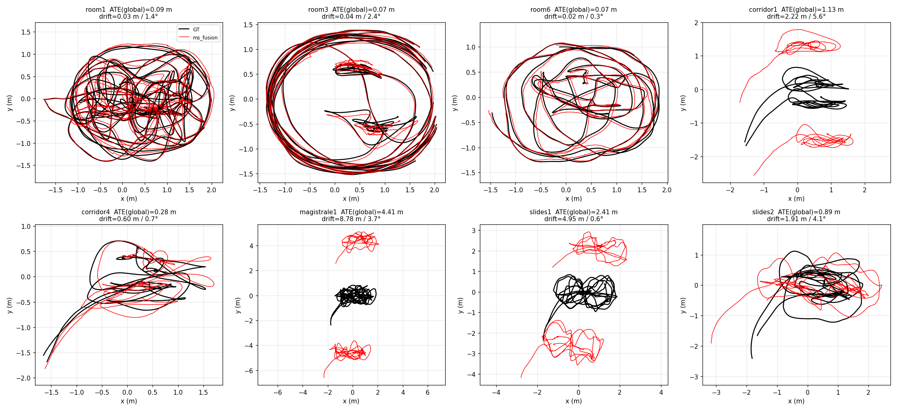
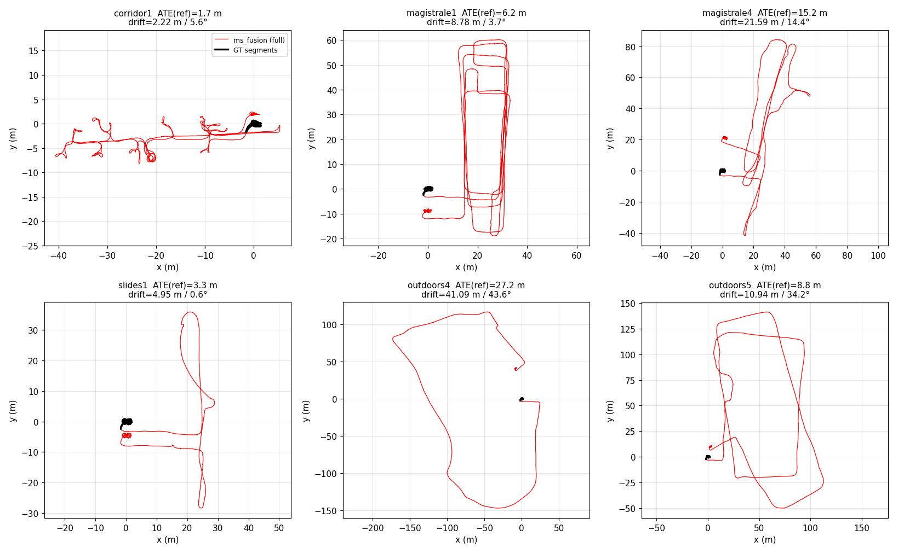
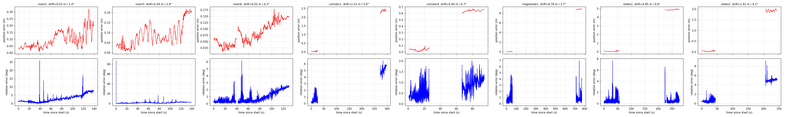

# TUM VI 全序列评测结果

在 AX650N 板端（离线回放，**1.0× 原始时基**）对 TUM VI 官方 512_16 导出的 **28 条序列 × 3 次**运行（共 84 次）的结果。
所有序列使用**同一份配置**（`calib_files/tumvi_room1/msf_robot.yaml` + 官方标定，仅 IMU 噪声按标定换算），
**没有逐序列调参，回环关闭（纯 VIO）**。

- 前端：XFeat 每帧 256 个特征点 + LightGlue 匹配（NPU），滑窗 `optimizer.window_size=8`，后端 Ceres。
- 板端以 `enable_timing_stats` 运行，耗时统计本身有少量开销。
- 逐次明细：[`runs.csv`](runs.csv)；表格生成与轨迹绘图脚本：`scripts/tumvi_report.py`、`scripts/tumvi_plot.py`。

## 指标说明

| 列 | 含义 |
|---|---|
| ATE Global-SE3 | **一次** SE(3)（无尺度）对齐，用该序列**全部有效 GT 位姿**拟合，再算全部点的 RMSE。对应 ORB-SLAM3 公开评估流程（单次整体对齐）的候选对比口径；对齐会吸收一部分累计误差。注：对应的是公开调用流程，未逐行核对其脚本实现 |
| ATE Reference-SE3（First-segment-aligned） | 只用**第一段有效 GT** 拟合 SE(3)，其余片段用同一变换，完整保留跨片段累计漂移。它通常比 Global-SE3 更能暴露累计漂移，但数学上不必然更大，也不是公开 Benchmark 的通用标准 |
| ATE Own-SE3 | **每个 GT 片段各自对齐**。只反映片段内部形状，会把片段间漂移拟合掉，**不能代表长期漂移**，仅用于局部诊断 |
| RPE 1s | 1 秒位移的平移误差 RMSE（用整体对齐的旋转把估计位移转到 GT 系，仅平移，不含旋转 RPE；只在同一无间断 GT 片段内配对） |
| 初始化失败 | 该序列 3 次运行中未完成初始化的次数 |
| 回环 | 本评测回环关闭，因此无回环数据 |
| 前端 Hz | 前端处理帧率（1 秒窗口的中位数，相机 20 Hz） |
| 前端 e2e / 后端 / 后端优化 P95 | **每个 1 秒统计窗口的均值所构成分布的 P95**（单位 ms），不是所有单次后端优化耗时的 P95 |
| 后端丢帧 | 关键帧在后端队列中被丢弃的次数 / 分钟 |
| GT 覆盖 | TUM VI 的动捕真值只在序列首尾（房间内）；**ATE 只在有 GT 的这些片段内计算**，不是整条轨迹。例如 corridor1 全程 299 s，GT 只有 2 段共 52 s |

除"完成/发散"列外，数值均为 3 次运行的**中位数**；仅统计状态为 `evaluated` 的运行。
"完成/发散"只表示**是否通过预设的发散筛查**（见下），不等于跟踪成功率；筛查只抓明显失效，抓不到中等漂移，精度请看 ATE。
发散判定（任一成立）：0.5 s 窗口内速度 > 20 m/s，或某 GT 片段内估计路程 / GT 路程不在 [1/2, 2]。
发散的序列 ATE 记为 N/A（数值无意义）。

## 全量结果（基线配置）

| 序列 | 完成/发散 | ATE Global-SE3 (m) | ATE Reference-SE3 (m) | ATE Own-SE3 (m) | RPE 1s (m) | 初始化失败 | 回环 | 前端 Hz | 前端 e2e P95 (ms) | 后端 P95 (ms) | 后端优化 P95 (ms) | 后端丢帧 (次/分) | GT 覆盖 |
|---|---:|---:|---:|---:|---:|---:|---:|---:|---:|---:|---:|---:|---|
| room1 | 3/3, 发散 0 | 0.12 | 0.14 | 0.07 | 0.036 | 0 | 关闭 | 19.3 | 92 | 80 | 70 | 12.8 | 3 段 / 139 s（序列 GT 跨度 141 s） |
| room2 | 3/3, 发散 0 | 0.16 | 0.25 | 0.05 | 0.049 | 0 | 关闭 | 19.2 | 91 | 89 | 79 | 18.6 | 10 段 / 131 s（序列 GT 跨度 144 s） |
| room3 | 3/3, 发散 0 | 0.20 | 0.23 | 0.15 | 0.047 | 0 | 关闭 | 19.1 | 91 | 98 | 89 | 34.9 | 10 段 / 130 s（序列 GT 跨度 141 s） |
| room4 | 3/3, 发散 0 | 0.10 | 0.10 | 0.10 | 0.029 | 0 | 关闭 | 19.6 | 90 | 79 | 69 | 10.7 | 1 段 / 111 s（序列 GT 跨度 111 s） |
| room5 | 3/3, 发散 0 | 0.17 | 0.17 | 0.17 | 0.052 | 0 | 关闭 | 19.2 | 91 | 76 | 67 | 10.4 | 1 段 / 142 s（序列 GT 跨度 142 s） |
| room6 | 3/3, 发散 0 | 0.05 | 0.06 | 0.04 | 0.017 | 0 | 关闭 | 19.9 | 87 | 90 | 78 | 19.4 | 2 段 / 128 s（序列 GT 跨度 131 s） |
| corridor1 | 3/3, 发散 0 | 8.54 | 12.67 | 0.10 | 0.648 | 0 | 关闭 | 19.5 | 90 | 97 | 87 | 23.7 | 2 段 / 52 s（序列 GT 跨度 299 s） |
| corridor2 | 3/3, 发散 0 | 2.02 | 3.00 | 0.17 | 0.158 | 0 | 关闭 | 19.8 | 91 | 93 | 83 | 25.5 | 2 段 / 71 s（序列 GT 跨度 339 s） |
| corridor3 | 3/3, 发散 0 | 2.29 | 3.63 | 0.10 | 0.189 | 0 | 关闭 | 19.6 | 90 | 87 | 78 | 15.1 | 2 段 / 60 s（序列 GT 跨度 290 s） |
| corridor4 | 3/3, 发散 0 | 0.34 | 0.55 | 0.10 | 0.164 | 0 | 关闭 | 19.7 | 91 | 91 | 82 | 20.0 | 2 段 / 53 s（序列 GT 跨度 94 s） |
| corridor5 | 3/3, 发散 0 | 0.88 | 0.89 | 0.03 | 0.092 | 0 | 关闭 | 19.7 | 91 | 95 | 85 | 25.6 | 3 段 / 40 s（序列 GT 跨度 285 s） |
| magistrale1 | 3/3, 发散 0 | 1.38 | 1.95 | 0.08 | 0.103 | 0 | 关闭 | 19.4 | 92 | 94 | 84 | 23.0 | 2 段 / 119 s（序列 GT 跨度 770 s） |
| magistrale2 | 3/3, 发散 0 | 9.95 | 14.29 | 0.06 | 0.434 | 0 | 关闭 | 19.4 | 93 | 100 | 90 | 28.7 | 2 段 / 98 s（序列 GT 跨度 538 s） |
| magistrale3 | 3/3, 发散 0 | 4.01 | 6.09 | 0.08 | 0.722 | 0 | 关闭 | 19.5 | 92 | 99 | 90 | 28.4 | 2 段 / 105 s（序列 GT 跨度 483 s） |
| magistrale4 | 3/3, 发散 0 | 9.87 | 14.47 | 0.39 | 1.113 | 0 | 关闭 | 19.7 | 92 | 95 | 85 | 24.1 | 2 段 / 148 s（序列 GT 跨度 623 s） |
| magistrale5 | 3/3, 发散 0 | 2.68 | 3.80 | 0.06 | 0.110 | 0 | 关闭 | 19.6 | 92 | 95 | 85 | 25.2 | 2 段 / 101 s（序列 GT 跨度 446 s） |
| magistrale6 | 3/3, 发散 0 | 5.75 | 8.62 | 0.10 | 0.553 | 0 | 关闭 | 19.8 | 91 | 102 | 92 | 48.3 | 2 段 / 79 s（序列 GT 跨度 575 s） |
| outdoors1 | 3/3, 发散 0 | 114.96 | 148.85 | 0.18 | 0.871 | 0 | 关闭 | 19.0 | 92 | 91 | 81 | 10.3 | 2 段 / 119 s（序列 GT 跨度 1282 s） |
| outdoors2 | 3/3, 发散 0 | 81.38 | 109.50 | 10.52 | 2.343 | 0 | 关闭 | 19.7 | 92 | 113 | 102 | 37.6 | 2 段 / 107 s（序列 GT 跨度 922 s） |
| outdoors3 | 0/3, 发散 3 | N/A | N/A | N/A | N/A | 0 | 关闭 | 19.9 | 89 | 68 | 58 | 2.7 | 3 段 / 120 s（序列 GT 跨度 844 s） |
| outdoors4 | 3/3, 发散 0 | 24.34 | 31.22 | 9.94 | 2.157 | 0 | 关闭 | 19.8 | 92 | 90 | 81 | 14.3 | 2 段 / 128 s（序列 GT 跨度 700 s） |
| outdoors5 | 0/3, 发散 3 | N/A | N/A | N/A | N/A | 0 | 关闭 | 19.9 | 90 | 107 | 97 | 44.7 | 2 段 / 138 s（序列 GT 跨度 887 s） |
| outdoors6 | 3/3, 发散 0 | 187.58 | 251.51 | 0.48 | 0.981 | 0 | 关闭 | 18.9 | 92 | 93 | 84 | 11.9 | 4 段 / 113 s（序列 GT 跨度 1470 s） |
| outdoors7 | 3/3, 发散 0 | 20.45 | 29.89 | 0.21 | 0.436 | 0 | 关闭 | 19.4 | 92 | 105 | 96 | 32.5 | 2 段 / 81 s（序列 GT 跨度 1120 s） |
| outdoors8 | 3/3, 发散 0 | 20.11 | 30.66 | 0.75 | 0.605 | 0 | 关闭 | 19.8 | 90 | 103 | 94 | 36.5 | 3 段 / 102 s（序列 GT 跨度 811 s） |
| slides1 | 3/3, 发散 0 | 1.05 | 1.46 | 0.07 | 0.144 | 0 | 关闭 | 19.7 | 91 | 97 | 87 | 26.2 | 3 段 / 108 s（序列 GT 跨度 279 s） |
| slides2 | 3/3, 发散 0 | 2.88 | 3.99 | 0.04 | 0.293 | 0 | 关闭 | 19.5 | 92 | 98 | 89 | 31.4 | 2 段 / 83 s（序列 GT 跨度 245 s） |
| slides3 | 3/3, 发散 0 | 2.06 | 2.94 | 0.08 | 0.159 | 0 | 关闭 | 19.4 | 92 | 94 | 85 | 23.2 | 2 段 / 96 s（序列 GT 跨度 362 s） |

### 要点

- **室内动捕房间（room1–6）**：ATE 0.05–0.20 m，全部 3 次运行稳定，RPE 0.02–0.05 m。
- **走廊 / slides / magistrale**：Global-SE3 ATE 约 0.3–10 m（corridor1 最差，8.5 m）；**outdoors7、8** 约 20 m。这些序列的 GT 只覆盖首尾，ATE 主要反映整条轨迹累计的漂移；Own-SE3 只有 0.03–0.8 m，说明每一段内部形状是好的，误差来自长期累计（尺度/航向漂移），不是局部跟踪质量。
- **室外（未发散的 outdoors1/2/4/6/7/8）**：Global-SE3 ATE 中位数 52.9 m，范围 20–188 m，组内差异很大（无回环）；其中 outdoors1/2/4/6 为 24–188 m，漂移明显。outdoors2、outdoors4 的 Own-SE3 也在 10 m 左右，局部精度本身就较差。
- **失败序列**：outdoors3（约 54 s 起立体视差塌缩、尺度爆炸，3/3 发散）和 outdoors5（末尾约 30 s 发散，3/3 发散）。保留在表中，未做任何筛选。
- **鲁棒性**：84 次运行 **0 次初始化失败**（初始化成功不代表全程跟踪可靠）；78/84 次通过预设发散筛查，另 6 次（outdoors3、outdoors5）未通过。通过筛查也不代表精度可接受，例如 outdoors6 的 Reference-SE3 ATE 达 251 m。
- **实时性**：前端 18.9–19.9 Hz（相机 20 Hz），回放保持 1.0× 时基能跟上；后端每次处理 P95 约 65–115 ms。注意：这是在回放 1.0× 时基、开启耗时统计下的统计，不等同于整机在线实时实测。
- **后端丢帧**从约 3 次/分（outdoors3）到 48 次/分（magistrale6）不等，与 ATE 没有简单对应（如 outdoors6 仅约 12 次/分却漂移最大），目前不能据此认定丢帧导致漂移；但说明只看前端平均帧率不足以评价实时性。
- Own-SE3 很小只说明有 GT 的片段内部形状接近，不能证明无 GT 区间的局部跟踪也好；outdoors1/6 的结论仅限于"首尾片段之间位姿不一致很大"，漂移从哪个时间点开始无法由 ATE 判断。
- 同一序列 3 次运行的 ATE 有明显波动（outdoors1 的 Reference-SE3 为 127–166 m），解读时应看分布而不是单次。

### 轨迹对比

估计轨迹只取 GT 覆盖片段，用一次 SE(3) 对齐后与 GT 叠加（顶视图，中位 ATE 的那次运行）；
走廊/室外这类 GT 只覆盖首尾的序列，GT 点集中在原点附近，所以几乎不可见，这类序列请看下一张漂移图。
最后的 outdoors3 是发散案例（量级 10⁵ m）。


整条估计轨迹只用第一段 GT 对齐（黑色为 GT 片段所在位置）。轨迹本应回到起点附近，起终点之间的缺口即累计漂移：


## 调参对比：使用 outdoors4 调过的参数重跑精度较差的序列

对基线里精度较差的 5 条序列，只改三项参数（其余完全不变，回环仍关闭），各重跑 3 次：
`imu.gb_std=1000`、`imu.ab_std=20000`（基线是按标定换算的 192.5 / 3648.7，即放宽 IMU 零偏先验）、`optimizer.keyframe_adaptive_floor_s=0.14`（基线 0.18）。
括号内为 3 次运行的单次值。

| 序列 | ATE Reference-SE3 (m) 基线 → 调参 | ATE Global-SE3 (m) 基线 → 调参 | RPE 1s (m) 基线 → 调参 |
|---|---|---|---|
| corridor1 | 12.7（12.7/18.0/11.5）→ **2.7**（2.0/2.7/2.8） | 8.5（8.5/12.3/7.7）→ **1.6**（1.1/1.6/1.7） | 0.65（0.65/0.66/0.65）→ **0.62**（0.62/0.63/0.62） |
| magistrale2 | 14.3（15.1/6.7/14.3）→ **10.2**（9.9/12.7/10.2） | 9.9（10.5/4.6/9.9）→ **7.1**（6.9/8.8/7.1） | 0.43（0.43/0.20/0.46）→ **0.30**（0.30/0.37/0.30） |
| outdoors2 | 109.5（109.5/106.2/117.6）→ **79.6**（91.5/73.9/79.6） | 81.4（81.4/78.9/87.4）→ **58.9**（67.7/54.8/58.9） | 2.34（2.32/2.34/2.38）→ **1.61**（1.54/1.62/1.61） |
| outdoors1 | 148.9（127.5/148.9/165.9）→ **124.9**（89.8/144.0/124.9） | 115.0（98.5/115.0/128.2）→ **96.8**（69.6/111.6/96.8） | 0.87（0.87/0.87/0.89）→ **0.35**（0.34/0.35/0.35） |
| outdoors6 | 251.5（239.9/261.3/251.5）→ **233.9**（233.9/221.1/348.2） | 187.6（178.9/194.9/187.6）→ **174.7**（174.7/165.1/260.1） | 0.98（0.98/0.99/0.98）→ **0.64**（0.64/0.56/0.71） |

- **corridor1 改善明显且可信**：三次都从 11–18 m 降到 2–3 m（分布完全分开）；outdoors2 也三次全部优于基线最好值（73.9–91.5 m vs 106–118 m）。
- **其余三条的 ATE 改善与基线重复间的波动同量级**（magistrale2、outdoors1、outdoors6 的分布有重叠，outdoors6 还出现了 348 m 的离群），不能据此认定变好。
- **RPE 在室外序列上稳定下降**（outdoors1 0.87→0.35 m，outdoors6 0.98→0.64 m，outdoors2 2.34→1.61 m），说明局部速度/位移估计更准；累计漂移（ATE）则未同比改善。
- **三项参数同时改动，无法区分 IMU 零偏先验与关键帧间隔各自的贡献**，需要分别消融（尚未做）；`gb_std`/`ab_std` 在代码中的单位与权重换算也应单独核对。
- 这组参数是对 outdoors4 调出来的，对其他序列只是试验；它不是通用配置，也未并入基线表。

## 新版二进制结果与基线对比（2026-10-19 构建，2026-10-20 评测）

用新构建的二进制（板端 `ms_fusion_node` md5 `e65304a0…`，构建于 2026-10-19 13:51）按**相同的流程和 YAML 模板**（同一份 room1 模板、`window_size=8`、`gb_std/ab_std` 为标定换算值、回环关闭、1.0× 回放）重跑 28 序列 × 3 次，
另外 `magistrale2` 的 run_01 因录制轨迹的 rclpy 进程崩溃（`failed to initialize wait set`，回放本身正常）无轨迹，已在同一 campaign 内补跑一次，所以仍是 3/3。
与上面的基线（2026-10-14 构建）相比，**YAML 模板相同，但代码及缺省参数发生变化**：主要有预积分旋转残差/雅可比的四元数符号分支一致化、
`imu.gyr_scale_std` 区间姿态协方差代理（默认 0.005）、消费线程改为谓词等待等
（见 `docs/preintegration_rot_jacobian_sign.md`、`docs/gyro_scale_covariance_proxy.md`）。
IMUErrorFactor 零偏先验以初始化 bg/ba 为中心、静止初始化取多窗口平均这两项只在静止初始化开启时生效，本次评测 `initializer.enable: false`，对结果没有影响。
**二进制对应的确切 commit 当时没有记录**，所以无法逐项归因。

- 全量表（格式同基线）：[`table_new_binary.md`](table_new_binary.md)；逐次明细：[`runs_new_binary.csv`](runs_new_binary.csv)（新增 `drift_deg` 列：相邻 GT 片段间累计漂移的旋转角，度）。
- 逐序列对比：[`table_comparison_baseline_vs_new.md`](table_comparison_baseline_vs_new.md)（下方）。括号内为 3 次运行的单次值，判断标准只看 3 次分布是否分开（新版最大 < 基线最小 为变好，反之为变差），其余记"重叠"，不做显著性断言。

| 序列 | ATE Reference-SE3 (m) 基线 → 新版 | ATE Global-SE3 (m) 基线 → 新版 | RPE 1s (m) 基线 → 新版 | 判断（3 次运行分布） |
|---|---|---|---|---|
| corridor1 | 12.67（12.67/17.97/11.51） → 1.68（1.68/1.10/1.94） | 8.54（8.54/12.28/7.72） → 1.13（1.13/0.56/1.30） | 0.648（0.648/0.657/0.647） → 0.214（0.189/0.371/0.214） | **变好**（新版最大 < 基线最小） |
| corridor2 | 3.00（3.05/2.79/3.00） → 2.18（2.34/2.10/2.18） | 2.02（2.07/1.89/2.02） → 1.47（1.58/1.42/1.47） | 0.158（0.168/0.131/0.158） → 0.110（0.110/0.097/0.118） | **变好**（新版最大 < 基线最小） |
| corridor3 | 3.63（3.97/2.99/3.63） → 1.58（1.63/1.58/1.39） | 2.29（2.50/1.86/2.29） → 0.94（0.98/0.94/0.82） | 0.189（0.188/0.203/0.189） → 0.155（0.155/0.161/0.155） | **变好**（新版最大 < 基线最小） |
| corridor4 | 0.55（0.45/0.55/0.69） → 0.47（0.47/0.44/0.56） | 0.34（0.29/0.34/0.45） → 0.28（0.28/0.27/0.36） | 0.164（0.127/0.164/0.182） → 0.127（0.127/0.124/0.135） | 分布重叠，不能判定 |
| corridor5 | 0.89（0.81/0.89/1.04） → 0.44（0.48/0.42/0.44） | 0.88（0.79/0.88/1.02） → 0.40（0.45/0.40/0.40） | 0.092（0.091/0.092/0.121） → 0.118（0.118/0.080/0.135） | **变好**（新版最大 < 基线最小） |
| magistrale1 | 1.95（1.44/1.95/2.35） → 6.19（6.19/7.82/2.53） | 1.38（1.01/1.38/1.67） → 4.41（4.41/5.56/1.80） | 0.103（0.128/0.086/0.103） → 0.045（0.045/0.117/0.042） | **变差**（新版最小 > 基线最大） |
| magistrale2 | 14.3（15.1/6.7/14.3） → 11.2（10.5/11.2/17.8） | 9.95（10.52/4.64/9.95） → 7.83（7.32/7.83/12.42） | 0.434（0.434/0.196/0.459） → 0.381（0.376/0.381/0.536） | 分布重叠，不能判定 |
| magistrale3 | 6.09（5.24/7.09/6.09） → 5.66（5.76/5.66/1.49） | 4.01（3.46/4.66/4.01） → 3.72（3.79/3.72/0.99） | 0.722（0.533/0.786/0.722） → 0.656（0.737/0.656/0.118） | 分布重叠，不能判定 |
| magistrale4 | 14.5（14.5/10.2/18.6） → 15.2（16.4/9.2/15.2） | 9.87（9.87/6.96/12.67） → 10.37（11.15/6.22/10.37） | 1.113（1.113/0.752/1.174） → 1.178（1.178/0.777/1.178） | 分布重叠，不能判定 |
| magistrale5 | 3.80（3.80/3.61/4.61） → 4.02（2.69/4.24/4.02） | 2.68（2.68/2.55/3.25） → 2.84（1.90/2.99/2.84） | 0.110（0.110/0.058/0.112） → 0.080（0.045/0.080/0.084） | 分布重叠，不能判定 |
| magistrale6 | 8.62（9.78/8.29/8.62） → 4.35（2.82/4.35/5.25） | 5.75（6.54/5.51/5.75） → 2.86（1.66/2.86/3.43） | 0.553（0.553/0.594/0.535） → 0.578（0.578/0.472/0.654） | **变好**（新版最大 < 基线最小） |
| outdoors1 | 148.9（127.5/148.9/165.9） → 168.6（162.2/218.9/168.6） | 114.96（98.46/114.96/128.19） → 130.26（125.31/169.28/130.26） | 0.871（0.871/0.870/0.887） → 0.885（0.876/0.914/0.885） | 分布重叠，不能判定 |
| outdoors2 | 109.5（109.5/106.2/117.6） → 120.0（114.2/120.0/123.9） | 81.38（81.38/78.94/87.39） → 88.90（84.54/88.90/91.71） | 2.343（2.317/2.343/2.380） → 0.833（0.831/0.833/0.839） | 分布重叠，不能判定 |
| outdoors3 | N/A → 105.0（76.8/105.0/116.1） | N/A → 74.44（54.50/74.44/82.34） | N/A → 0.473（0.491/0.473/0.464） | 基线发散，无可比值 |
| outdoors4 | 31.2（33.3/31.2/26.0） → 27.2（24.5/27.2/32.5） | 24.34（25.96/24.34/20.82） → 20.50（18.40/20.50/24.48） | 2.157（2.157/2.062/2.277） → 0.866（0.839/0.866/0.890） | 分布重叠，不能判定 |
| outdoors5 | N/A → 8.84（8.84/11.88/7.89） | N/A → 5.54（5.54/7.51/5.00） | N/A → 0.873（0.886/0.873/0.550） | 基线发散，无可比值 |
| outdoors6 | 251.5（239.9/261.3/251.5） → 245.4（245.4/239.1/260.2） | 187.58（178.86/194.92/187.58） → 182.99（182.99/178.29/194.06） | 0.981（0.980/0.988/0.981） → 0.975（0.975/0.970/0.985） | 分布重叠，不能判定 |
| outdoors7 | 29.9（33.8/29.9/25.9） → 34.3（34.3/37.3/31.1） | 20.45（23.23/20.45/17.70） → 23.54（23.54/25.67/21.31） | 0.436（0.391/0.436/0.460） → 0.327（0.327/0.286/0.382） | 分布重叠，不能判定 |
| outdoors8 | 30.7（26.2/39.4/30.7） → 29.1（33.0/22.8/29.1） | 20.11（17.20/25.82/20.11） → 19.09（21.60/14.90/19.09） | 0.605（0.590/0.704/0.605） → 0.677（0.732/0.646/0.677） | 分布重叠，不能判定 |
| room1 | 0.14（0.14/0.13/0.14） → 0.11（0.11/0.12/0.08） | 0.12（0.12/0.12/0.12） → 0.09（0.09/0.09/0.07） | 0.036（0.035/0.036/0.037） → 0.034（0.034/0.043/0.030） | **变好**（新版最大 < 基线最小） |
| room2 | 0.25（0.25/0.27/0.24） → 0.28（0.28/0.19/0.29） | 0.16（0.16/0.16/0.14） → 0.16（0.16/0.11/0.16） | 0.049（0.049/0.050/0.048） → 0.045（0.051/0.045/0.045） | 分布重叠，不能判定 |
| room3 | 0.23（0.23/0.31/0.22） → 0.10（0.10/0.13/0.09） | 0.20（0.18/0.24/0.20） → 0.07（0.07/0.08/0.07） | 0.047（0.047/0.051/0.046） → 0.029（0.031/0.029/0.028） | **变好**（新版最大 < 基线最小） |
| room4 | 0.10（0.10/0.09/0.10） → 0.05（0.07/0.04/0.05） | 0.10（0.10/0.09/0.10） → 0.05（0.07/0.04/0.05） | 0.029（0.027/0.029/0.029） → 0.027（0.027/0.027/0.028） | **变好**（新版最大 < 基线最小） |
| room5 | 0.17（0.23/0.16/0.17） → 0.07（0.07/0.08/0.07） | 0.17（0.23/0.16/0.17） → 0.07（0.07/0.08/0.07） | 0.052（0.063/0.042/0.052） → 0.039（0.039/0.039/0.035） | **变好**（新版最大 < 基线最小） |
| room6 | 0.06（0.06/0.10/0.05） → 0.09（0.15/0.09/0.09） | 0.05（0.05/0.07/0.04） → 0.07（0.10/0.07/0.07） | 0.017（0.019/0.017/0.017） → 0.023（0.023/0.024/0.022） | 分布重叠，不能判定 |
| slides1 | 1.46（1.46/1.50/1.31） → 3.35（3.37/1.10/3.35） | 1.05（1.05/1.08/0.95） → 2.41（2.42/0.80/2.41） | 0.144（0.144/0.151/0.073） → 0.254（0.254/0.109/0.266） | 分布重叠，不能判定 |
| slides2 | 3.99（3.99/3.17/4.98） → 1.30（1.30/1.99/0.65） | 2.88（2.88/2.28/3.62） → 0.89（0.89/1.45/0.44） | 0.293（0.303/0.276/0.293） → 0.153（0.260/0.120/0.153） | **变好**（新版最大 < 基线最小） |
| slides3 | 2.94（2.94/2.68/3.10） → 2.73（2.73/2.13/4.05） | 2.06（2.06/1.88/2.17） → 1.91（1.91/1.49/2.84） | 0.159（0.159/0.078/0.178） → 0.039（0.198/0.035/0.039） | 分布重叠，不能判定 |

### 结论

- **84 次运行 0 次初始化失败，0 次被发散筛查判定为发散**（基线是 6 次，全在 outdoors3 / outdoors5）。
  注意：筛查只抓"瞬移 / 尺度爆炸或塌缩"，outdoors3 的 Reference-SE3 ATE 仍有约 105 m，outdoors5 约 8.8 m，**"不再被判发散"不等于"跟踪好了"**。
- **28 序列里 10 条明显变好**：room1/3/4/5、corridor1/2/3/5、magistrale6、slides2；其中 corridor1 从 12.7 m 降到 1.7 m、slides2 从 4.0 m 降到 1.3 m。
  **15 条分布重叠**（无法判定，含全部室外长序列），**1 条明显变差：magistrale1**（1.95 → 6.19 m），另有 2 条基线发散的 outdoors3/5 无可比值。
- **局部精度整体显著提升**：Own-SE3 ATE 普遍降低，例如 outdoors2 10.5 → 0.10 m、outdoors4 9.9 → 0.20 m、outdoors8 0.75 → 0.08 m、magistrale4 0.39 → 0.08 m；
  室外 RPE 1s 也明显下降（outdoors2 2.34 → 0.83 m，outdoors4 2.16 → 0.87 m）。即每个 GT 片段内部形状更准，
  但**GT 片段之间的累计漂移（Reference-SE3）没有同比改善**，outdoors1/2/6/7 仍在 30–250 m 量级。
- **前端帧率不变**（18.8–19.9 Hz，与基线同）；后端优化 P95 中位数 +2.6 ms，丢帧中位数 +3.9 次/分，
  但这两项的变化与 ATE 的变化几乎不相关（对数 ATE 比值与两者的相关系数分别为 0.09、-0.05），不能解释精度变化。

### 退化序列分析（magistrale1、slides1，以及轻微的 room6）

只看数据，不做未经验证的归因：

1. **不是尺度问题**：基线与新版每个 GT 片段自身的带尺度对齐（Sim(3)）尺度都是 1.00 ± 0.02。
2. **magistrale1 / slides1 的第二段误差在段内基本恒定**（magistrale1 run_01 为 8.72 → 8.82 m），是一个刚体偏移，在两段 GT 之间（magistrale1 约 650 s 的无真值间隔、slides1 约 170 s）累计而成；不是段内发散。
3. **新版运行间离散更大**：magistrale1 基线 3 次为 1.44 / 1.95 / 2.35 m，新版为 2.53 / 6.19 / 7.82 m；slides1 基线 1.31–1.50 m，新版 1.10 / 3.35 / 3.37 m，
   最好的一次（1.10 m）反而优于基线最好值，说明同一份二进制同一份数据会走向**两种结局**。slides1 的三次轨迹在约 68 s（数据时间）之前几乎重合，此后才分叉，约 150 s 内拉开到 4 m 左右。
4. **视觉汇总统计相近**：分叉前后好坏两次运行的 `vis_n`（约 90–165）、双目因子占比、白化视觉残差量级基本一致，未见明显整体约束塌缩；这些汇总不能排除局部错配或同一 ID 的几何历史截断。
5. **陀螺零偏 z 分量在运行间发散得最明显**（magistrale1 约 78 s 处 bg_z 为 0.23 / 0.54 / 0.10 mrad/s，约 232 s 处 0.14 / 0.27 / 0.04，与三次的 ATE 排序 6.19 / 7.82 / 2.53 完全同序）。
   但 slides1、room6 上这个对应关系不成立（slides1 最差的一次之一 bg_z 反而最小），**所以它只是线索，不能当作根因**。

**已有的间接证据指向 `imu.gyr_scale_std`（默认 0.005）**：基线构建于该参数加入（2026-10-16）之前，等价于 `gyr_scale_std=0`。
当时（2026-10-15，尚未含符号修复）单独试过 `0.005 / 0.01`，每条序列只跑了 1 次，ATE Reference-SE3 (m) 与基线对比如下：

| 序列 | 基线（≈0，3 次） | 0.005（1 次） | 0.01（1 次） | 新版默认 0.005（3 次） |
|---|---|---|---|---|
| magistrale1 | 1.44 / 1.95 / 2.35 | 5.85 | 4.95 | 6.19 / 7.82 / 2.53 |
| slides1 | 1.46 / 1.50 / 1.31 | 2.45 | 3.02 | 3.37 / 1.10 / 3.35 |
| slides3 | 2.94 / 2.68 / 3.10 | 4.29 | 5.30 | 2.73 / 2.13 / 4.05 |
| outdoors7 | 33.8 / 29.9 / 25.9 | 38.9 | 48.4 | 34.3 / 37.3 / 31.1 |
| outdoors1 | 127.6 / 148.9 / 165.9 | 221.8 | 220.5 | 162.2 / 218.9 / 168.6 |

这 5 条序列在 `0.005` 和 `0.01` 下的单次值都在基线 3 次分布之外（偏大），与 `docs/gyro_scale_covariance_proxy.md` 记录的"个别序列有代价（outdoors1/7、magistrale1、slides1/3）"一致，
slides1、slides3、outdoors7 还随取值增大而变差。相反，同一参数明显改善 corridor1（12.7 → 2.1 m）、slides2（4.0 → 0.7 m）以及 outdoors3/5 的发散。
推测机理（**未验证**）：该代理给预积分区间的姿态协方差加了与累计转角成比例的方差，等于放松了陀螺的姿态约束；陀螺误差大的剧烈转动段因此受益，
而陀螺本身可信的长序列里视觉对航向的约束更弱，累计漂移变大。官方资料没有给出校正后的残余比例误差，`0.5%` 是经验值（见下）。

这组早期实验仍是**间接证据**：当时每个取值只跑 1 次，且不含后来的预积分符号修复。
2026-10-20 已补充同一新二进制下的 `0 / 0.002` 对照，magistrale1、slides1 每个取值各 2 次，结果见下表；尚未达到每个取值 ≥ 3 次。
其余仍可能的因素：预积分旋转残差/雅可比符号分支一致化、线程同步方式带来的时序变化（均未验证）。
room6 的 0.06 → 0.09 m 绝对量很小，与基线分布仅轻微重叠。

**新二进制上的 `gyr_scale_std` 小扫描（2026-10-20，每格 2 次，magistrale1 / slides1；outdoors3/5 各 1 次）**，ATE Reference-SE3 (m)：

| 序列 | 基线（旧二进制，≈0，3 次） | 新二进制 `0`（2 次） | 新二进制 `0.002`（2 次） | 新二进制 `0.005`（3 次） |
|---|---|---|---|---|
| magistrale1 | 1.44 / 1.95 / 2.35 | 3.53 / 4.26 | 8.95 / 4.93 | 6.19 / 7.82 / 2.53 |
| slides1 | 1.46 / 1.50 / 1.31 | 1.17 / 0.87 | 1.42 / 1.55 | 3.37 / 1.10 / 3.35 |
| outdoors3 | 发散 3/3 | — | 101.4（未判发散，路程比 1.15） | 76.8 / 105.0 / 116.1 |
| outdoors5 | 发散 3/3 | — | 6.9（未判发散，路程比 1.04） | 8.8 / 11.9 / 7.9 |

- **slides1**：`0` 与 `0.002` 的 4 次都在 0.87–1.55 m，而 `0.005` 有 2/3 次在 3.4 m，与"`gyr_scale_std` 偏大导致 slides1 变差"一致，但每格只有 2 次。
- **magistrale1 结论不明朗**：新二进制 `0` 的两次（3.53 / 4.26）仍高于旧二进制基线的最大值（2.35），`0.002` 的两次（8.95 / 4.93）也没有比 `0.005` 好。
  说明关闭代理仍未恢复旧版水平，**不能用 `gyr_scale_std` 单独解释全部退化**；尚需区分其他代码变化、处理帧选择与运行间波动，不能根据这几次结果量化各项原因的贡献。
- **outdoors3 / outdoors5**：`0.002` 下都没有被判发散，开头段没有回到 `0` 时"几乎必发散"的状态，但各只有 1 次。
- 因此**目前不足以支持把默认值从 0.005 改为 0.002**：slides1 在两者之间没有被区分，magistrale1 不随取值单调变化，样本量也太小。

**关于 `gyr_scale_std` 的取值依据**：TUM VI 官方页面给出了原始陀螺的比例矩阵（对角约 0.944 / 1.094 / 1.016，即未校正时三轴比例误差约 −5.6% / +9.4% / +1.6%），
并说明 calibrated 数据集已经校正了 IMU 的比例/轴失准（论文式 (2)：`ω_calibrated = Mg·ω_raw − bg`，`Mg` 九个元素全部拟合）；
但官方**没有给出校正后的残余比例误差**，所以 `0.5%` 在官方资料里没有依据，只是针对 outdoors3/5 开头发散调出来的经验值。

### 新版轨迹与误差曲线

GT 片段内对齐的顶视图（中位 ATE 的那次运行），其标题的 `drift` 为相邻 GT 片段间的累计平移 / 旋转漂移：



整条估计轨迹只用第一段 GT 对齐的累计漂移视图：



位置误差（m）与旋转误差（deg）随时间的曲线，对齐方式与上面的 Reference-SE3 一致（只用第一段 GT 拟合一次）。
以 room1 为例，约 39 s、46 s 等处会出现约 26° 的单点尖峰，三次运行一致（其余序列未逐一核对），更像动捕姿态在片段边界处的跳变，而不是估计问题：



## 复现

```bash
# 评测编排脚本（下载 → 预处理 → 板端回放 → 回传 → 评估）见 docs/tumvi_room1_board_eval.md 的流程；
# 已有各次运行的 *_vio_est.tum 与预处理缓存时，可离线重算全部表格：
python3 scripts/tumvi_report.py --cache <缓存目录> --out <输出目录> <campaign 目录>
python3 scripts/tumvi_plot.py   --cache <缓存目录> --out figures/trajectory_gt_spans.png <campaign 目录> room1 room3 corridor4 ...
python3 scripts/tumvi_plot.py   --cache <缓存目录> --full --out figures/trajectory_drift.png <campaign 目录> corridor1 outdoors4 ...
# 加 --errors 额外输出位置/旋转误差随时间曲线（<out>_errors.png）
```
